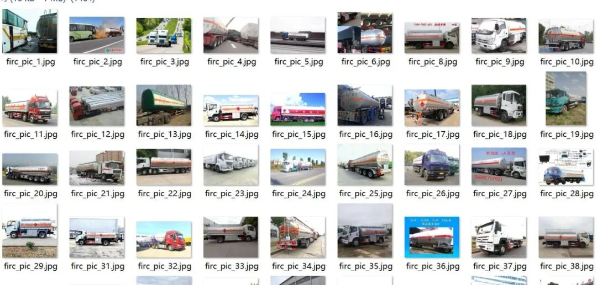
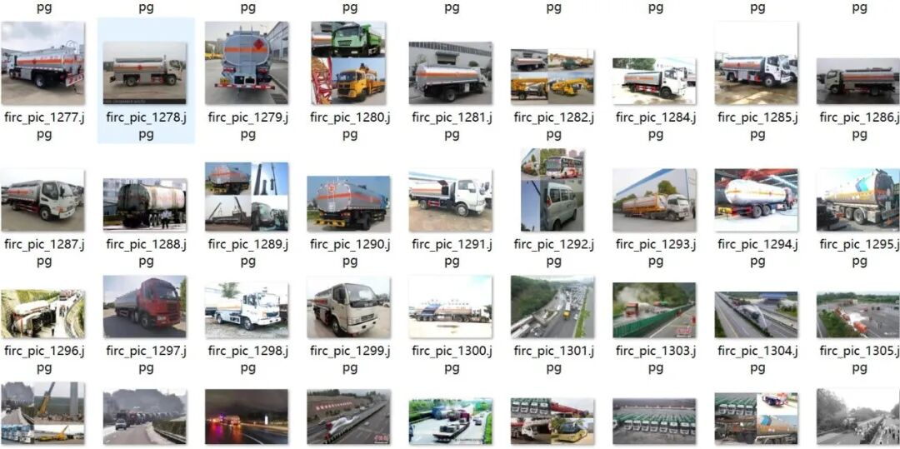
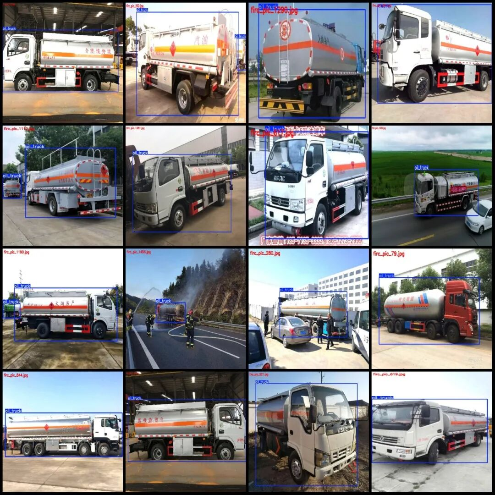
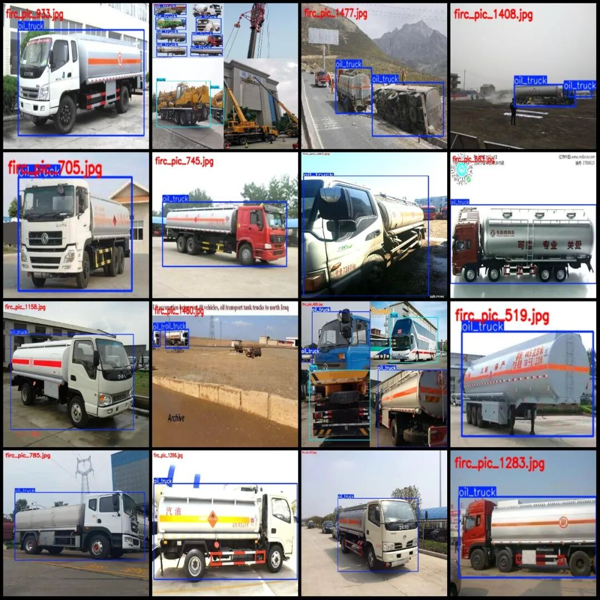

# Dataset for Vehicular Inspection of Hazardous Chemicals in VOC+YOLO format, 1499 images across 3 categories

Dataset format: Pascal VOC format + YOLO format (txt file without split path, only containing jpg images and corresponding VOC format xml files and yolo format txt files)

Number of images (number of jpg files): 1499

Number of annotations (number of xml files): 1499

Number of annotations (number of txt files): 1499

Label category count: 3

Label category names (Note that the order of yolo format categories does not correspond to this, but is based on the classes.txt in the labels folder): ["bus", "oil_truck", "truck"]

Number of boxes labeled in each category:

Bus (bus) Frames = 98

Oil_truck (oil tanker) Frames = 2379

Truck (truck) Frame Count = 168

Total frame count: 2645

Number of images per category:

Bus occupancy count = 75

Oil truck occupies 1499 images.

Truck occupancy count = 85

Image resolution: Multi-resolution images, such as 1080x810, 1333x768, etc.

Using labelImg:

Annotation rules: Draw a rectangle around the category.

Important Notice: The dataset does not have separate training, validation, and test sets; you need to partition them yourself.

Special : This dataset does not guarantee the accuracy of the trained models or weight files.

Image Preview:

Annotation example:

## Payment

Here is a pay link on Stripe ( https://buy.stripe.com/3cs8yP7sY87d0vu9AB ). Please contact me lonlonago@foxmail.com after funding $89, and I will send you a complete data files , thank you!

